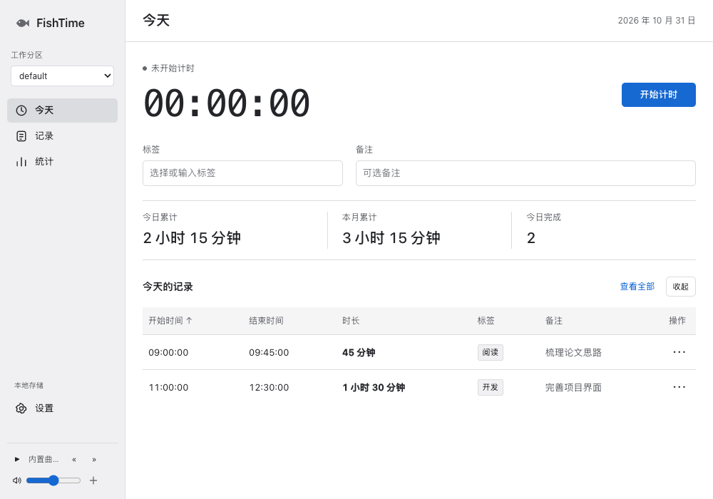
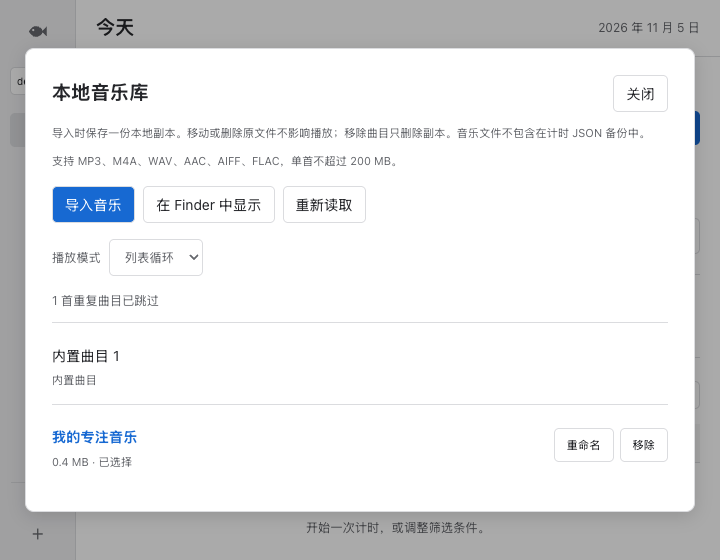

# FishTime
(Codex刚出来的时候做的一个计时工具，安装包达到200多Mb；ChatGPT 5.6模型进行了重构，大小不到10Mb。仅供个人学习使用。)

> 时间，留在你的设备里。

FishTime 是一款轻量的本地计时与统计工具。它用工作分区整理不同项目，通过标签、图表、日历和预测把投入时间变得清晰可见；需要时也可以使用 AI 将当天的记录整理成摘要。

FishTime 坚持“本地优先”：计时记录默认只保存在电脑上，支持自行导入和导出备份。

## FishTime 5

全新暖灰与青绿界面，围绕“今天、记录、统计”组织内容。计时数字与主要操作位于首页中心；历史记录支持搜索、日期／标签筛选和列表／日历切换。界面支持跟随系统、浅色、深色及兼容旧版的色块模式。



以上预览使用测试记录，不包含个人数据。更多预览：[历史记录](docs/screenshots/records.png)、[深色日历](docs/screenshots/calendar-dark.png)。

## 功能一览

- **专注计时**：开始、暂停、结束计时；支持标签、备注及超时提醒。
- **菜单栏计时**：右上角查看本次时长、今日累计和当前分区，直接开始、暂停、继续或结束并保存。
- **多工作分区**：为不同工作或生活主题建立独立分区，数据互不混杂。
- **记录与统计**：按日、月和日历查看投入时长，支持记录编辑、删除、排序与筛选。
- **可视化洞察**：标签柱状图、饼图、时长色阶日历及当月投入预测。
- **AI 总结（可选）**：支持 Gemini 和硅基流动，按需总结当天记录；结果按日缓存。
- **数据掌握在自己手中**：可导出或导入 JSON 备份；完整备份包含全部工作分区与设置。
- **舒适界面**：中英文、跟随系统／浅色／深色／色块主题，以及可永久保存的本地音乐库。

### 本地音乐库

1. 点击左下角播放器的 **＋**，或进入 **设置 → 本地音乐库 → 管理曲目**。
2. 点击“导入音乐”，可以一次选择多个普通音频文件。支持 MP3、M4A、WAV、AAC、AIFF、FLAC，单首最大 200 MB；加密的会员下载格式不能直接播放。
3. 点击曲目名称即可播放；支持重命名、移除、单曲循环和列表循环。播放器记住所选曲目与循环模式，重启后不会自动开始播放。

导入时会复制音频，原始文件保持在原位置。移动或删除原文件不会影响已导入的曲目；在库中“移除”只删除副本，不删除原文件。相同内容重复导入会自动跳过；副本缺失时可重新导入原文件修复。

音乐库默认位于 `~/Library/Application Support/com.fishtime.desktop/music/`，可点击“在 Finder 中显示”打开。升级或替换 FishTime.app 不会删除这里的文件，音乐也不会进入安装包或上传 GitHub。



5.1 及更早版本临时添加的曲目，需要重新选择原文件导入一次，才能永久保存。

**计时 JSON 备份不包含音乐文件。** 如需迁移或备份音乐，请单独复制整个 `music` 文件夹（包括 `library.json`），不要手动改动库内文件名。清空当前分区的计时记录不会删除共享音乐库。

### 三个工作页面

- **今天**：秒级计时、标签与备注、今日及本月累计、今天的记录。计时按钮随开始／暂停状态切换。
- **记录**：全部历史记录，支持标签与备注搜索、日期与标签筛选；点击每行的 `⋯` 编辑或删除。切换到日历可查看任意日期的记录。
- **统计**：选择月份查看总投入、日均时长、活跃天数、每日趋势和标签排行；本月预测和可选的 AI 总结也在此处。
- **设置**：左下角进入，管理分区、外观、语言、模块、AI 服务，以及 JSON 导入导出。

统计页日均投入按所选月份已过的日历天数计算，包含零记录日期；历史月份按整月计算。本月预测和“本月标签汇总”固定针对当前月份，不随概览的月份选择改变。

## macOS 使用方法

当前发布包面向 **Apple Silicon（M 系列）Mac**，需要 **macOS 10.15 或更高版本**。

1. 前往 [Releases](https://github.com/pxxiao-hz/FishTime/releases/latest)，下载最新版本的 Apple Silicon DMG。
2. 双击打开 DMG，把 `FishTime.app` 拖到“应用程序（Applications）”文件夹。
3. 首次打开时，因当前版本没有 Apple Developer 证书和公证，macOS 可能提示“无法验证开发者”。请在“应用程序”中**按住 Control 点击（或右键点击）FishTime → 打开 → 打开**；如仍被阻止，请前往“系统设置 → 隐私与安全性”，选择“仍要打开”。
4. 从旧版迁移时：先在旧版 FishTime 中“导出数据”，再在新版本的设置中选择“导入数据”并选取 JSON 文件。

> 安装包为 ad-hoc 签名，尚未公证；这会触发首次运行的 Gatekeeper 提示，但不影响本地功能。无需 Apple ID，也不会要求登录。

### 菜单栏使用

- 启动后，屏幕右上角出现小鱼图标；计时时显示 `▶ 00:25:38`，暂停时显示 `Ⅱ 00:25:38`。
- 默认不在程序坞或 `Command-Tab` 切换列表中显示；主窗口仍可正常使用，通过右上角菜单栏打开窗口、设置或 About FishTime。
- 点击图标，可以控制当前工作分区的计时，查看本次时长与今日累计。“结束并保存”沿用主窗口中填写的标签和备注。
- 点击红色关闭按钮或按 `Command-W` 只会隐藏主窗口，计时继续；通过菜单栏的“打开 FishTime”恢复窗口。
- 选择“退出 FishTime”或按 `Command-Q` 会暂停所有分区的活动计时并退出。下次启动后可以继续或结束保存。
- 菜单栏不展示标签、备注和 AI 内容。睡眠期间沿用原来的计时规则：未暂停的时间会计入时长，唤醒后按时间戳刷新。

### 检查更新与自动安装

- 从 **设置 → 软件更新 → 检查更新**，或右上角小鱼菜单中的 **检查更新…** 进入；About FishTime 中也有相同入口。
- 发现新版后，点击 **下载并安装**。下载时可以继续计时；下载并校验完成后，App 会保存标签和备注、暂停活动计时、安装并重新启动。
- 默认在启动后自动检查，持续运行时每 24 小时检查一次。短时间重新启动会复用近期检查结果；后台检查失败保持安静，最多每小时重试一次。
- 发现新版时显示 App 内横幅、设置页标记，并在菜单栏计时文字后显示 `•`；不会自动打开弹窗、下载、安装或重启。选择“查看更新”后再决定是否安装。
- 支持“24 小时后提醒”“跳过此版本”，跳过仅影响该版本；手动检查仍能查看和安装。设置中可恢复提示，也可关闭“自动检查更新”。这些选择在重启后保留。
- 自动检查与手动检查均不会发送计时记录、标签、备注或 AI Key。网络请求仅用于从 GitHub 获取版本清单和签名安装包；未申请 macOS 系统通知权限。
- 更新失败时可重试或选择手动下载。从 DMG 中直接运行的 App，需要先移入“应用程序”，退出并重新打开后再更新。
- **5.0.0 及更早版本需要手动安装一次 5.1.0 或更新版本**，之后才能使用 App 内更新。
- 5.2.0 及更早版本尚无自动提醒，需要先使用手动“检查更新”升级到 5.3.0 或更新版本。关闭主窗口但保持菜单栏运行时仍可检查；完全退出后不会检查或提醒。

## 数据与隐私

- 计时数据、分区和界面设置默认存放在本机的系统 WebView 数据库中；FishTime 不提供账号、云同步或遥测上传。
- 可以随时从设置中导出 JSON 备份。完整备份不包含 AI API Key。
- 在 macOS 桌面版中，AI API Key 保存到 macOS 钥匙串（Keychain），不会写入本地数据备份或 GitHub 源码。
- AI 功能完全可选。只有在你主动生成 AI 总结时，相关记录内容才会发送给你选择的 AI 服务商；请在使用前阅读该服务商的隐私政策。

## 备份与兼容性

- v5 保留 v4 的本地存储标识和备份格式，升级后原记录可继续使用，无需转换。
- v5 可以导入 v4 完整备份，以及旧 Electron 版导出的 `records + activeSession` JSON。
- 完整备份包含所有工作分区、模块设置和 AI 总结缓存，同时保留旧版兼容字段。
- 建议升级前先导出一次旧数据，并妥善保存 JSON 文件；它是跨版本迁移的可靠方式。

## 开发

```bash
npm install
npm test         # 计时与菜单栏回归测试
npm start        # Tauri 开发/调试
npm run dist     # 构建 macOS App 和 DMG
```

首次开发前还需要安装 [Rust](https://www.rust-lang.org/tools/install)。构建出的 DMG 位于：

```text
src-tauri/target/release/bundle/dmg/
```

可选的 UI 回归测试需要本机安装 Google Chrome，并可通过 Node 解析 `playwright` 模块，再运行 `npm run test:ui`。测试使用隔离浏览器和合成记录，截图写入临时目录；可通过 `FISHTIME_SCREENSHOT_DIR` 指定截图目录。此工具仅用于开发，不包含在安装包中。

### 发布维护

发布包必须使用与 `src-tauri/tauri.conf.json` 公钥匹配的更新签名私钥。构建脚本优先读取 `TAURI_SIGNING_PRIVATE_KEY`，否则使用维护者本机的 `~/.config/fishtime/signing/updater.key`；可选密码通过 `TAURI_SIGNING_PRIVATE_KEY_PASSWORD` 提供。私钥应保存在仓库外并备份，不要提交、上传或重新生成来替换现有密钥。

`npm run dist` 会生成 DMG、`FishTime.app.tar.gz`、其 `.sig` 签名以及 `dist/latest.json`。每次发布需将这四个文件上传到同一个 GitHub Release，并在验证完成后将其设为 latest，才能让已安装版本找到更新。更新包签名与 Apple Developer ID／公证是两套不同机制。

不持有发布密钥的开发者可以运行 `npm start`；如需本地构建，在 Tauri 配置中临时关闭 `bundle.createUpdaterArtifacts`，使用 `npm run tauri -- build`，不要将未签名构建用作官方自动更新。

## 项目结构

- `index.html`、`style.css`、`main.js`：界面和核心逻辑
- `src-tauri/`：Tauri/Rust 桌面壳、原生菜单、权限和打包配置
- `scripts/prepare-web.js`：生成最小化的 Tauri 前端资源目录
- `scripts/build-release.js`：发布构建自动替换 Rust 中的本机源码路径，避免安装包包含开发者主目录信息

## 更新日志

### 5.3.0

- 新增启动后与每 24 小时自动检查更新，发现新版时显示轻量横幅、设置页标记和菜单栏提示。
- 支持 24 小时后提醒、跳过单个版本、恢复提示和关闭自动检查，并持久保存在本机。
- 后台失败不弹错误，限制重试频率；手动检查可覆盖跳过选择。下载和安装仍需用户明确点击。

### 5.2.0

- 新增可永久保存的本地音乐库，原生多文件导入，重启／升级后可继续使用。
- 导入时创建副本并按文件内容去重，支持重命名、移除确认、缺失副本修复、单曲与列表循环。
- 音频仅通过限定音乐目录的本地协议读取，原始文件不被修改或删除；支持从设置和窄窗口播放器打开音乐库。

### 5.1.0

- 设置、菜单栏和 About 中新增检查更新入口；支持查看版本、下载进度、签名校验、安装和重启。
- 安装前保存并暂停全部分区计时，保留当前未完成的标签与备注。
- 新增签名更新清单生成流程，私钥仅保存在维护者本机；提供网络／安装失败反馈和手动下载入口。

### 5.0.0

- 全新侧栏导航与“今天／记录／统计”三页布局；暖灰／青绿视觉系统及自适应窄窗口布局。
- 首页突出秒级计时，状态切换时只显示相关操作，标签与备注合并为轻量输入区。
- 历史记录新增搜索、日期／标签筛选和分页加载；行内更多菜单统一提供编辑／删除，删除确认显示记录详情。
- 统计页新增日均投入与活跃天数，标签分布默认采用横向排行；预测、AI 总结和月度明细集中管理。
- 支持跟随系统主题；统一深色图表、日历、设置、弹窗和键盘焦点样式。
- 保留菜单栏计时、隐藏程序坞、本地数据与旧 JSON 兼容性；增加真实浏览器 UI 回归测试。

### 4.1.1

- 默认以 macOS 菜单栏应用运行，启动和打开窗口时均不显示程序坞图标。
- 在右上角菜单栏中加入设置和 About FishTime，保留隐藏程序坞后的访问入口。

### 4.1.0

- 新增原生菜单栏计时及开始、暂停、继续、结束并保存操作，与主窗口共用记录和操作逻辑。
- 关闭主窗口后保持菜单栏驻留；退出应用前自动暂停并保存所有分区的活动计时状态。
- 原生菜单栏根据时间戳刷新，支持跨午夜的今日累计及中英文切换。

### 4.0.7

- 移除界面右上角的 About FishTime 按钮；About 仅保留在 macOS 顶部菜单中。

### 4.0.6

- 在 macOS 顶部菜单的 **FishTime** 子菜单中加入 **About FishTime**，点击可查看版本与隐私说明。

### 4.0.5

- 增加“重新计算”预测按钮，并在窗口重新获得焦点时自动重算。
- 新增 About FishTime，可查看实际运行版本、本地优先和备份说明。
- 所有 `saveRecords()` 数据写入后都会立即刷新预测，确保删除等操作不会遗留旧结果。

### 4.0.4

- 删除、编辑、导入或清空记录后，本月总时长预测会立即重新计算，不受当前页面影响。

### 4.0.3

- 删除记录改为应用内确认对话框，规避 macOS WebView 原生确认框可能不显示的问题。

### 4.0.2

- 修复旧记录 ID 为数字时，今日记录的删除/编辑操作无效的问题。
- 工作日历详情新增编辑和删除操作，可直接处理昨天及任意历史日期的记录。

### 4.0.1

- 恢复旧版 FishTime 的 macOS 应用图标，并在 Tauri 打包配置中显式声明图标资源。

### 4.0.0

- 从 Electron 迁移至 Tauri 2，使用 macOS 系统 WKWebView，发布包显著缩小。
- 保留计时、统计、分区、AI 总结和背景音乐能力，并优化深色主题、图表空状态和窄窗口布局。
- 新增全分区 v2 备份格式，兼容旧版 JSON 导入；跨午夜计时会拆分为正确的日期记录。
- AI Key 改存 macOS 钥匙串；原生菜单改为 Tauri Rust 实现，并收紧权限和内容安全策略。

## 许可证

[ISC](LICENSE)
